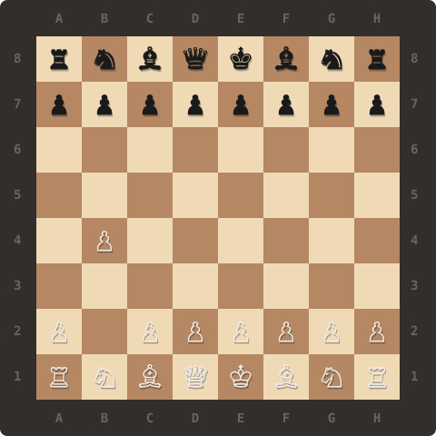

# Chào mừng bạn đến với Profile của tôi! 🚀

## ♟️ Trợ thủ Cờ vua trực tiếp trên README

Tạo một **Issue** mới với tiêu đề dạng `Chess: <nước_đi>` (ví dụ: `Chess: e4`, `Chess: e2e4`) hoặc `Chess: reset` để làm mới bàn cờ!

### Trạng thái ván đấu:
- **Lượt đi:** ⚫ Quân Đen (Black)
- **Người chơi gần nhất:** 👤 [@`Hung-Nguyen-Quoc11278`](https://github.com/Hung-Nguyen-Quoc11278)
- **Tình trạng:** Đang diễn ra

### Bàn cờ hiện tại:

<p align="center">
  
</p>

### 📜 Lịch sử nước đi:
```text
1. d2d4 
```

**FEN hiện tại:** `rnbqkbnr/pppppppp/8/8/3P4/8/PPP1PPPP/RNBQKBNR b KQkq d3 0 1`

---
*Được vận hành tự động bởi **Golang** & **GitHub Actions**.*
